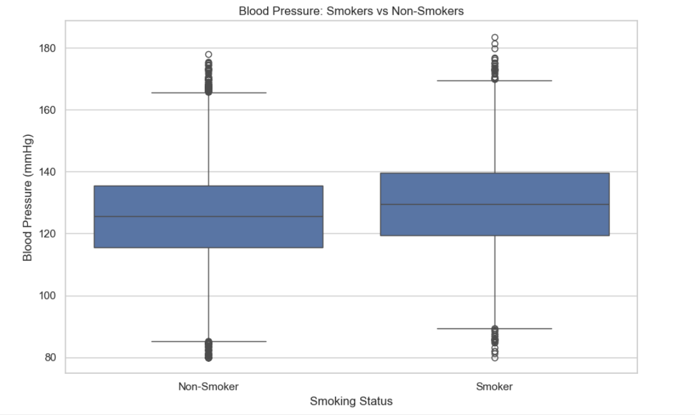

# Derivable Judgement: A Statistical Decision-Making Model

### A Python-Based Statistical Analysis Project Using Health Data

**Project Repository:** `Maths-PR2-Derivable-Judgement-Statistical-Decision-Model`

---

## 📌 Project Overview

**Derivable Judgement: A Statistical Decision-Making Model** is a Python-based statistical analysis project designed to demonstrate how statistical techniques can be applied to health-related data to identify patterns, examine relationships, test hypotheses, and support evidence-based decision-making.

The project uses a structured health dataset and applies descriptive statistics, confidence intervals, hypothesis testing, correlation, covariance, and data visualization.

The analysis demonstrates how statistical methods can help evaluate relationships between variables such as age, Body Mass Index (BMI), blood pressure, smoking status, and diabetes status.

> **Disclaimer:** The dataset used in this project is synthetically generated for educational and statistical practice. The findings do not represent real patients and must not be used for medical diagnosis or clinical decision-making.

---

## 🎯 Project Objectives

The main objectives of this project are:

- To understand and apply fundamental statistical concepts using Python.
- To explore and summarize health-related data using descriptive statistics.
- To visualize distributions and patterns in the dataset.
- To calculate confidence intervals for numerical variables.
- To formulate null and alternative hypotheses.
- To perform hypothesis tests and interpret their p-values.
- To apply the Chi-Square test to examine categorical associations.
- To use a t-test to compare the means of two groups.
- To apply One-Way ANOVA to compare means across multiple groups.
- To calculate Pearson correlation and covariance between numerical variables.
- To interpret statistical results using a significance level of 0.05.
- To communicate findings through tables, graphs, and a final conclusion.

---

## 📂 Repository Structure

The repository contains the following files:

```text
Maths-PR2-Derivable-Judgement-Statistical-Decision-Model/
│
├── Derivable_Judgement_Statistical_Analysis.ipynb
├── derivable_judgement_health_dataset.csv
│
├── Age Distributions of individuals.png
├── Blood Pressure Differentiation.png
├── Correlation Heatmap of Health Variables.png
├── Covariance of Health Variables.png
├── Diabetes Prevalence by Smoking Status.png
├── Distribution of Diabetes.png
├── Distribution of Smoking status.png
│
├── .gitignore
└── README.md
```

*Note: The repository structure above reflects the expected project files. The notebook and image filenames should match the files actually uploaded to GitHub.*

---

## 📊 Dataset Description

The project uses a structured health dataset containing **50,000 synthetic records** and 15 columns.

### Dataset File

`derivable_judgement_health_dataset.csv`

### Dataset Variables

| Column | Description |
|---|---|
| `record_id` | Unique identifier for each record |
| `age_group` | Age category of the individual |
| `age` | Age in years |
| `weight` | Weight measurement |
| `gender` | Gender category |
| `region` | Geographical region |
| `smoking_status` | Smoking-status category |
| `exercise_frequency` | Exercise-frequency category |
| `bmi` | Body Mass Index |
| `blood_pressure` | Blood-pressure measurement |
| `diabetes` | Diabetes-status category |
| `hypertension` | Hypertension-status category |
| `cholesterol_level` | Cholesterol measurement |
| `glucose_level` | Glucose measurement |
| `visit_date` | Date associated with the record |

### Dataset Preparation

The dataset is loaded into a Pandas DataFrame for analysis. Initial exploration includes:

- Inspecting the number of records and columns.
- Checking column data types.
- Calculating descriptive statistics.
- Examining categorical distributions.
- Checking for missing values and duplicate identifiers.
- Preparing numerical and categorical variables for statistical analysis.

Because the dataset is synthetic, its distributions and relationships should not be interpreted as representative of a real population.

---

## 🛠️ Technologies and Libraries

The project uses the following technologies:

| Technology | Purpose |
|---|---|
| Python | Main programming language |
| Jupyter Notebook | Interactive analysis environment |
| Pandas | Data loading, cleaning, and manipulation |
| NumPy | Numerical computations |
| SciPy | Statistical tests and probability distributions |
| Matplotlib | Data visualization |
| Seaborn | Statistical charts and heatmaps |
| Statsmodels | Supporting statistical analysis |

---

## 📈 Statistical Methods Used

### 1. Descriptive Statistics

Descriptive statistics summarize the dataset using measures such as:

- Mean
- Median
- Standard deviation
- Minimum and maximum
- Quartiles
- Frequency distributions

These measures help describe the characteristics and distribution of the dataset.

### 2. Confidence Intervals

Confidence intervals estimate a plausible range for a population parameter using sample data.

This project calculates **95% confidence intervals** for selected numerical variables, including:

- Age
- Weight
- BMI
- Blood pressure
- Cholesterol level
- Glucose level

The intervals are calculated using the t-distribution.

### 3. Hypothesis Testing

Hypothesis testing evaluates statistical evidence against a null hypothesis.

The project uses a significance level of:

**α = 0.05**

The hypotheses are interpreted using the calculated p-values.

- If `p-value < 0.05`, reject the null hypothesis.
- If `p-value ≥ 0.05`, fail to reject the null hypothesis.

Failing to reject the null hypothesis does not prove that it is true.

### 4. Chi-Square Test of Independence

**Comparison:** Smoking status and diabetes status.

The Chi-Square test examines whether there is evidence of an association between two categorical variables.

- **Null hypothesis (H₀):** Smoking status and diabetes status are independent.
- **Alternative hypothesis (H₁):** Smoking status and diabetes status are associated.

The decision is based on the calculated Chi-Square statistic and p-value.

### 5. Pearson Correlation Analysis

**Comparison:** Age and BMI.

Pearson correlation measures the strength and direction of a linear relationship between two numerical variables.

The correlation coefficient ranges from `-1` to `+1`.

- A positive coefficient indicates a positive linear relationship.
- A negative coefficient indicates a negative linear relationship.
- A coefficient near zero indicates a weak or absent linear relationship.

The p-value helps evaluate whether the observed correlation is statistically significant.

### 6. Independent-Samples t-Test

**Comparison:** Blood pressure between smokers and non-smokers.

Welch's independent-samples t-test compares the mean values of two independent groups without assuming equal population variances.

- **Null hypothesis (H₀):** The two group means are equal.
- **Alternative hypothesis (H₁):** The two group means are different.

The p-value is used to evaluate the evidence for a difference in mean blood pressure.

### 7. One-Way ANOVA

**Comparison:** Mean blood pressure across age groups.

One-Way Analysis of Variance (ANOVA) tests whether the means of multiple independent groups are equal.

- **Null hypothesis (H₀):** All age groups have the same mean blood pressure.
- **Alternative hypothesis (H₁):** At least one age group has a different mean blood pressure.

A statistically significant result indicates that at least one group mean differs, but does not identify which groups differ without further analysis.

### 8. Covariance Analysis

Covariance measures how two numerical variables vary together.

- Positive covariance indicates that the variables tend to move in the same direction.
- Negative covariance indicates that they tend to move in opposite directions.
- Covariance near zero indicates limited linear co-variation.

The covariance matrix summarizes relationships between selected numerical variables.

---

## 📉 Data Visualizations

The project includes visualizations to make the statistical analysis easier to understand.

### Age Distribution

Displays the distribution of ages within the dataset.


### Blood Pressure Differentiation

Visualizes blood-pressure differences or distributions examined in the analysis.



### Correlation Heatmap

Displays Pearson correlation coefficients between selected numerical health variables.


### Covariance Heatmap

Shows the covariance between selected numerical health variables.


### Diabetes Prevalence by Smoking Status

Visualizes diabetes prevalence across smoking-status categories.


### Diabetes Distribution

Shows the distribution of diabetes-status categories in the dataset.


### Smoking Status Distribution

Shows the frequency of the smoking-status categories.


*Note: GitHub displays these images when their filenames and paths match the files in the repository.*

---

## ▶️ How to Run the Project

Follow these steps to run the notebook on your computer.

### Step 1: Clone the Repository

Open a terminal or command prompt and execute:

```bash
git clone https://github.com/Yashraj-datascience-ml/Derivable-Judgement-Statistical-Decision-Model.git
```

### Step 2: Open the Project Folder

```bash
cd Derivable-Judgement-Statistical-Decision-Model
```

### Step 3: Install the Required Libraries

```bash
pip install pandas numpy scipy matplotlib seaborn statsmodels jupyter
```

### Step 4: Launch Jupyter Notebook

```bash
jupyter notebook
```

### Step 5: Open the Analysis Notebook

Open:

`Derivable_Judgement_Statistical_Analysis.ipynb`

Run the notebook cells sequentially, from the beginning to the end.

**Important:** Keep `derivable_judgement_health_dataset.csv` in the same directory as the notebook unless the dataset path in the code is updated.

---

## 🧪 Hypothesis Testing and Decision Rules

The project uses hypothesis testing to make statistical decisions.

| Condition | Statistical Decision |
|---|---|
| p-value < 0.05 | Reject the null hypothesis |
| p-value ≥ 0.05 | Fail to reject the null hypothesis |

A statistical decision should be accompanied by an explanation of the test, the variables compared, the p-value, and the practical meaning of the result.

Statistical significance does not necessarily imply practical importance or causation.

---

## 🔍 Expected Learning Outcomes

By completing this project, the learner gains practical experience in:

- Loading and exploring structured datasets.
- Calculating descriptive statistics.
- Creating statistical visualizations.
- Computing confidence intervals.
- Formulating and testing hypotheses.
- Applying Chi-Square, t-test, and ANOVA methods.
- Measuring correlation and covariance.
- Interpreting p-values and critical values.
- Documenting analytical work in Jupyter Notebook.
- Presenting statistical results in a reproducible format.

---

## ⚠️ Limitations

- The dataset is synthetically generated and does not represent actual patients.
- Results depend on the structure and assumptions of the generated dataset.
- Statistical associations do not establish cause-and-effect relationships.
- Statistical tests require their assumptions to be considered before interpreting results.
- Findings should not be used for medical diagnosis, treatment, or real-world clinical decisions.
- Statistical conclusions should be based on the actual outputs produced by the notebook.

---

## 🏁 Conclusion

The **Derivable Judgement: A Statistical Decision-Making Model** project demonstrates how Python-based statistical techniques can be used to explore data, evaluate hypotheses, quantify uncertainty, and communicate findings.

By combining descriptive statistics, confidence intervals, hypothesis testing, Chi-Square analysis, t-tests, ANOVA, correlation, covariance, and visualizations, the project provides a practical introduction to statistical decision-making.

The project also highlights the importance of interpreting p-values carefully, understanding statistical limitations, and distinguishing statistical association from causation.

Overall, it provides hands-on learning in statistical analysis, data visualization, and evidence-based reasoning using Python.

---

## 👨‍💻 Author

**GitHub:** [Yashraj-datascience-ml](https://github.com/Yashraj-datascience-ml)

**Project:** Derivable Judgement — A Statistical Decision-Making Model

---

## 📄 Disclaimer

This project is intended for educational and academic purposes only. The dataset is synthetic, and the results must not be interpreted as real-world medical evidence or used for clinical decision-making.
